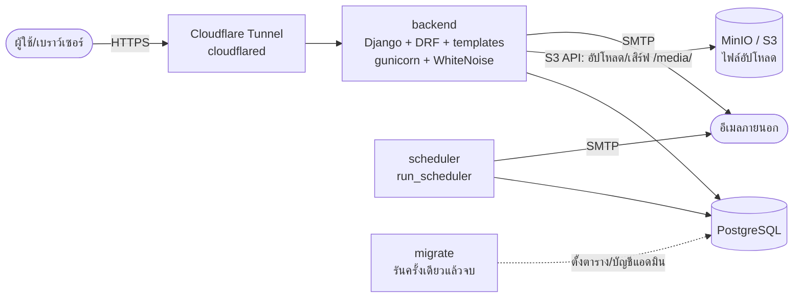
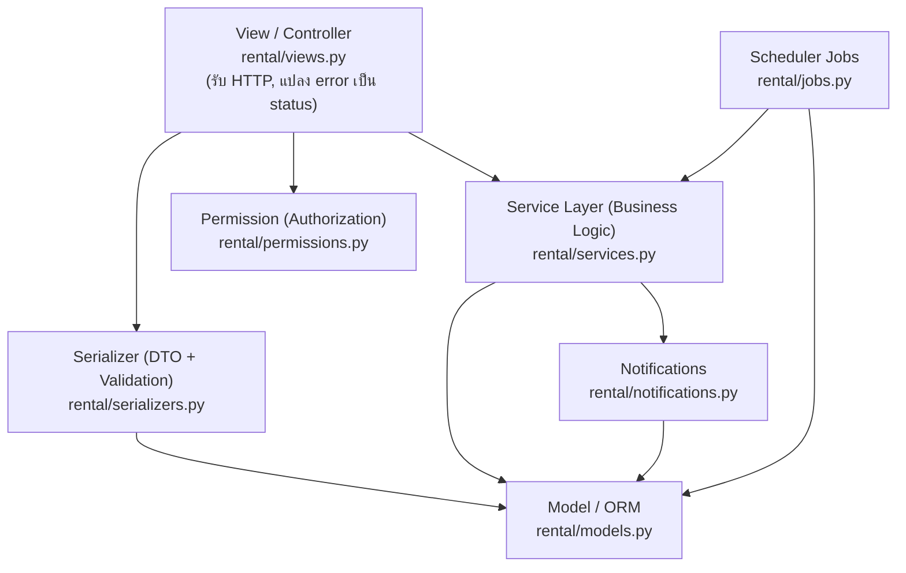
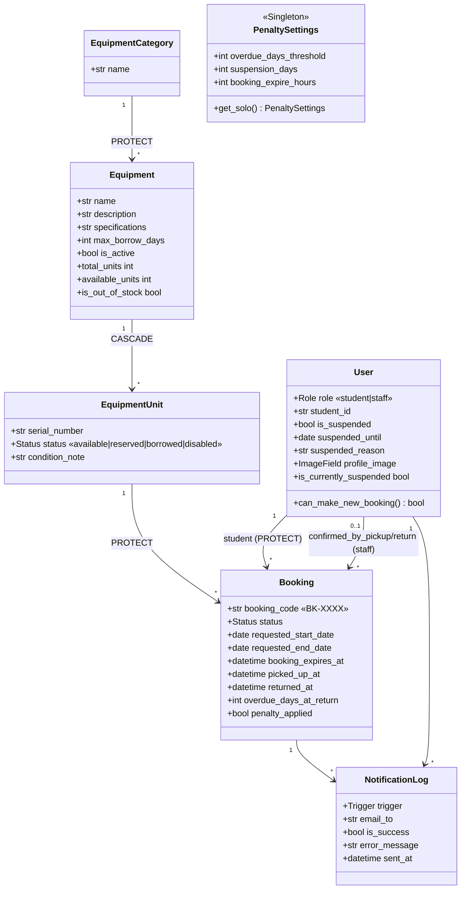

# 2. สถาปัตยกรรมและการออกแบบระบบ (Architecture & Class Design)

## 2.1 ภาพรวมสถาปัตยกรรม

### 2.1.1 มุมมอง Component (ตอน deploy จริงด้วย Docker Compose)

แต่ละกล่องคือ 1 container เรียกหากันด้วยชื่อ service ภายใน docker network ทางเข้าจากอินเทอร์เน็ตมี **ทางเดียว** คือ Cloudflare Tunnel



จุดออกแบบที่สำคัญ:
- **Django เป็นทางเข้าเดียว** — หน้าเว็บ (`/`, Django templates ใน `backend/frontend/`), API (`/api/`), static (WhiteNoise), `/media/` (ดึงจาก MinIO) อยู่ origin เดียวกัน ไม่มี CORS; หน้า dashboard เช็คล็อกอิน/role ฝั่งเซิร์ฟเวอร์ (`frontend/decorators.py`); `/api/admin/` ปิดเมื่อ `ENABLE_DJANGO_ADMIN=False`
- **scheduler แยก container** จาก backend — งานเบื้องหลังไม่ไปแย่ง worker ที่ตอบหน้าเว็บ (`docker-compose.yml:95`)
- **แยกไฟล์ compose เป็น infra กับแอป** — `docker-compose.infra.yml` (PostgreSQL + MinIO) ถูก `include` เข้า `docker-compose.yml` (migrate/backend/scheduler/cloudflared) ยกทั้งระบบด้วยคำสั่งเดียวได้เหมือนเดิม และยก infra อย่างเดียวไว้พัฒนาด้วย `runserver` ได้
- **migrate เป็น job รันครั้งเดียว** — `backend`/`scheduler` รอให้เสร็จก่อน (`condition: service_completed_successfully`) กัน migrate ชนกัน 2 ตัวตอน DB ยังว่าง (`docker-compose.yml:79-81`)

### 2.1.2 มุมมอง Layered (ภายใน backend)

Backend จงใจแยกเป็นชั้น ไม่ยัด logic ไว้ใน view แบบ Django ทั่วไป:



| ชั้น | หน้าที่เดียว (Single Responsibility) |
|------|-------------------------------------|
| View | รับ request, เรียก service, แปลง `BookingError` → HTTP 400 — ไม่มี business rule |
| Serializer | ตรวจความถูกต้องของข้อมูลเข้า + รูปแบบข้อมูลออก |
| Service | กฎธุรกิจทั้งหมด (จอง/รับ/คืน/ปรับ) + คุม transaction |
| Permission | ตัดสินสิทธิ์ตามบทบาท |
| Model | โครงสร้างข้อมูล + behavior ของข้อมูลเอง (เช่น `can_make_new_booking()`) |

## 2.2 Class Diagram และความสัมพันธ์

ที่มา: `backend/rental/models.py` — ความสัมพันธ์หลักคือ
`EquipmentCategory 1—* Equipment 1—* EquipmentUnit 1—* Booking *—1 User`



ประเด็นออกแบบที่ตอบคำถามอาจารย์ได้:
- **ทำไมแยก `Equipment` (รุ่น) กับ `EquipmentUnit` (ชิ้น)?** เพื่อจองและตัดสต็อกที่ระดับชิ้นจริง — จำนวนคงเหลือ = `COUNT(EquipmentUnit.status='available')` คำนวณสด ไม่เก็บตัวเลขนิ่งที่อาจไม่ตรง (`models.py:141-155`)
- **ทำไม `Booking.student` และ `Booking.unit` ใช้ `on_delete=PROTECT`?** เพื่อกันลบผู้ใช้/อุปกรณ์ที่มีประวัติการยืม — รักษาหลักฐาน (`models.py:259,262`); view แปลง `ProtectedError` เป็นข้อความอ่านง่าย
- **ทำไม `PenaltySettings` เป็น Singleton?** ให้เจ้าหน้าที่ปรับกฎค่าปรับผ่านหน้าจอได้โดยไม่แก้โค้ด (ดู SOLID: OCP ด้านล่าง)

## 2.3 การประยุกต์ใช้ SOLID (High Cohesion & Low Coupling)

### ตัวอย่างที่ 1 — SRP + Low Coupling: Service Layer แยก business logic ออกจาก HTTP

View ทำแค่รับ request และแปลง error ไม่รู้กฎธุรกิจเลย ส่วนกฎทั้งหมดอยู่ใน service — ชั้นทั้งสองจึงแก้แยกกันได้และ **service เดียวกันถูกใช้ซ้ำทั้งจาก API และจากเทสต์**

```python
# rental/services.py:31 — ข้อผิดพลาดเชิงธุรกิจเฉพาะทาง (ไม่ใช่ bug)
class BookingError(Exception):
    """view จะจับ exception นี้แล้วแปลงเป็น HTTP 400 พร้อมข้อความที่อ่านรู้เรื่อง"""
```

```python
# rental/views.py (MyBookingListCreateView.create) — view "บาง": เรียก service แล้วแปลง error
try:
    booking = create_booking(
        student=request.user,
        equipment_id=serializer.validated_data["equipment_id"],
        start_date=serializer.validated_data["start_date"],
        end_date=serializer.validated_data["end_date"],
    )
except BookingError as exc:
    return Response({"detail": str(exc)}, status=status.HTTP_400_BAD_REQUEST)
```

> **High Cohesion:** แต่ละฟังก์ชันใน `services.py` = 1 use case (`create_booking`, `cancel_booking`, `confirm_pickup`, `confirm_return`) · **Low Coupling:** View ไม่แตะสถานะโมเดลตรง ๆ เลย

#### จุดสำคัญที่สุดของทั้งระบบ — กัน race condition ด้วย DB lock (อยู่ในชั้น service)

```python
# rental/services.py:93 — *** จุดกัน race condition ที่สำคัญที่สุด ***
unit = (
    EquipmentUnit.objects
    .select_for_update(skip_locked=True)
    .filter(equipment=equipment, status=EquipmentUnit.Status.AVAILABLE)
    .first()
)
if unit is None:
    raise BookingError("อุปกรณ์นี้ถูกจองครบแล้วในขณะนี้ กรุณาลองใหม่ภายหลัง")
unit.status = EquipmentUnit.Status.RESERVED
unit.save(update_fields=["status", "updated_at"])
```
ทุกการเปลี่ยนสถานะอยู่ใน `transaction.atomic()` + `select_for_update()` — สองคนกดจองชิ้นสุดท้ายพร้อมกัน มีเพียงคนเดียวที่ได้ (`skip_locked` ให้คนที่สองได้ของชิ้นอื่นหรือข้อความ "ของหมด" ทันที ไม่ค้าง)

### ตัวอย่างที่ 2 — DIP + ISP: Authorization แยกเป็น Permission class เล็ก ๆ

สิทธิ์ตามบทบาทถูกแยกเป็นคลาสเล็กหน้าที่เดียว แล้ว DRF "ฉีด" (inject) เข้ามาให้ view — view เพียงประกาศว่าต้องใช้สิทธิ์อะไร ไม่ต้องเขียน if เช็ค role เองในทุก method

```python
# rental/permissions.py:4
class IsStaffUser(BasePermission):
    """อนุญาตเฉพาะผู้ใช้ role='staff' (เจ้าหน้าที่) เท่านั้น"""
    message = "การทำรายการนี้ต้องเป็นเจ้าหน้าที่เท่านั้น"
    def has_permission(self, request, view):
        user = request.user
        return bool(user and user.is_authenticated and user.role == user.Role.STAFF)
```
```python
# การใช้งานใน view — ประกาศแบบ declarative
class StaffEquipmentListCreateView(...):
    permission_classes = [IsStaffUser]
```
> **ISP:** แยก `IsStaffUser` / `IsStudentUser` เป็นคนละคลาส view ขึ้นกับเฉพาะสิทธิ์ที่ตัวเองต้องใช้ · **DIP:** view ขึ้นกับ abstraction (`BasePermission`) ไม่ใช่ logic ตรวจสิทธิ์ที่ hardcode

### (เสริม) OCP — ปรับพฤติกรรมได้โดยไม่แก้โค้ด ผ่าน `PenaltySettings` singleton

```python
# rental/models.py:217
@classmethod
def get_solo(cls) -> "PenaltySettings":
    obj, _ = cls.objects.get_or_create(pk=1)
    return obj
```
`confirm_return()` อ่านเกณฑ์ค่าปรับจาก `PenaltySettings.get_solo()` (`services.py:193`) เจ้าหน้าที่เปลี่ยนจำนวนวันพักสิทธิ์/เกณฑ์เกินกำหนดผ่านหน้าจอได้ โดย**ไม่ต้องแก้แล้ว deploy ใหม่** — เปิดรับการเปลี่ยนแปลง (open for extension) แต่ปิดการแก้โค้ด (closed for modification)

## สรุปจุดเด่นเชิงออกแบบ (ไว้ตอบ Q&A)
1. **Service layer + DB-level locking** = ตัวอย่าง High Cohesion/Low Coupling ที่จับต้องได้จริง
2. **Permission class แยกบทบาท** = ISP/DIP
3. **Singleton settings** = OCP
4. **แยกรุ่น/ชิ้น + PROTECT** = โมเดลข้อมูลสะท้อนโดเมนจริงและรักษาหลักฐาน
