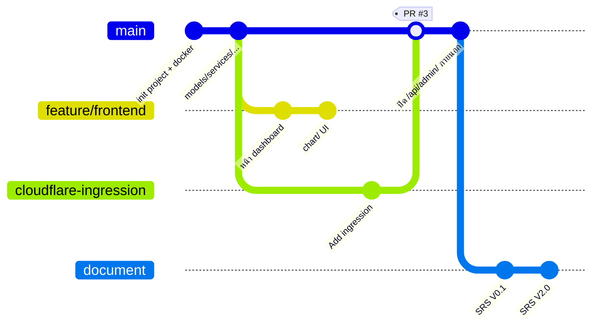

# 3. การทำงานร่วมกันผ่าน Git (Team Collaboration Workflow)

> Repo: `github.com/Parkjindream/it-device-borrowing-system` · รวม **117 commits** (บน `main` 107) · ช่วงพัฒนา ~3 สัปดาห์ (ต.ค. 2569)

## 3.1 Branching Strategy

ใช้รูปแบบ **main + feature branch** (แตกกิ่งตามงาน แล้วรวมกลับผ่าน Pull Request):



| Branch | บทบาท |
|--------|-------|
| `main` | สายหลักที่พร้อม deploy |
| `feature/frontend` | งานหน้าเว็บ (dashboard, chart) — ตั้งชื่อตามแบบแผน `feature/<ชื่อ>` |
| `cloudflare-ingression` | งานเพิ่มทางเข้าผ่าน Cloudflare Tunnel — รวมกลับผ่าน **PR #3** |
| `document` | เอกสาร SRS (แยกออกจากโค้ดเพื่อไม่รบกวนสายโปรแกรม) |

## 3.2 Commit History, Pull Requests และ Code Review

### การกระจายงานสะท้อนผ่าน Git Contribution
| Commits | ผู้พัฒนา | หมายเหตุ |
|:---:|------|------|
| 59 | Parkjindream | หัวหน้าโปรเจกต์/งานหลัก backend+infra |
| 42 | Anawin Boonchuay | (อีเมลเดียวกับ Parkjindream — เครื่อง/บัญชี git คนละตัวของผู้พัฒนาคนเดียวกัน) |
| 7 | Wanchana `68030267@kmitl.ac.th` | |
| 3 | nutthapat `68030359@kmitl.ac.th` | |
| 6 | `gitea-ci` | บัญชีอัตโนมัติ (งาน infra) |

> **ข้อควรพูดเองตอนนำเสนอ (ความซื่อสัตย์ทางเทคนิค):** ชื่อ `Parkjindream` และ `Anawin Boonchuay` ใช้อีเมลเดียวกัน = ผู้พัฒนาคนเดียวตั้งค่า `git config user.name` ไว้คนละค่าบนคนละเครื่อง เราทราบประเด็นนี้และวิธีแก้คือตั้ง `user.email` ให้ตรงกันทุกเครื่อง เพื่อให้สถิติ contribution สะท้อนคนจริงถูกต้อง

### ตัวอย่าง Pull Request + Code Review
- **PR #3** `cloudflare-ingression` → `main` (merge commit `66f501e`) : เพิ่มการเปิดระบบสู่อินเทอร์เน็ตผ่าน Cloudflare Tunnel รีวิวแล้วรวมเข้าหลัก
- เลข PR #3 บ่งชี้ว่ามี PR #1, #2 ก่อนหน้า (รวมแบบ fast-forward จึงไม่เหลือ merge commit)

### ตัวอย่าง Commit ที่ "มีความหมาย" (เล่าได้ว่าแก้อะไร)
```
2181e15  ปิด /api/admin/ จากภายนอก ใช้ผ่านเราเอง   ← งานด้านความปลอดภัย
d46f109  update ความปลอดภัย notifications.py
ca3a183  update ความปลอดภัย settings.py
5962b33  Delete ngrok.yml                          ← เลิกใช้ ngrok เปลี่ยนไป Cloudflare
```

### สิ่งที่ยอมรับว่าควรปรับปรุง (โชว์ว่าเข้าใจมาตรฐาน)
1. **ข้อความ commit หลายอันกว้างไป** เช่น `update all`, `update y`, `แก้ไข layout` (ซ้ำ) — ควรใช้รูปแบบ **Conventional Commits** เช่น `fix(frontend): แก้ layout การ์ดอุปกรณ์ซ้อนกันบนมือถือ`
2. **ยังไม่มีโฟลเดอร์ `.github/`** สำหรับ PR template / CODEOWNERS / required review — แผนปรับปรุงคือเพิ่ม template และตั้ง branch protection ให้ `main` ต้องผ่าน review + ผ่าน CI (ดู [10-cicd.md](10-cicd.md)) ก่อน merge
3. **บาง branch (`feature/frontend`, `document`) ยังไม่ merge กลับ** — ควรปิดงานและรวมหรือลบ branch ที่ไม่ใช้

> หลังจากเพิ่ม CI (ไฟล์ `.github/workflows/ci.yml`) ทุก PR จะถูกตรวจ lint + รันเทสต์อัตโนมัติก่อน merge ทำให้กระบวนการ review มีหลักฐานเชิงเทคนิครองรับ ไม่ใช่รีวิวด้วยสายตาอย่างเดียว
