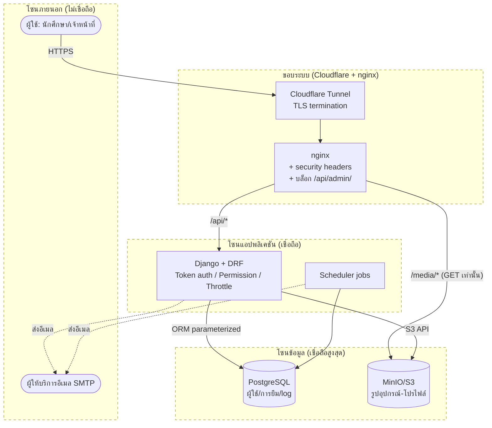
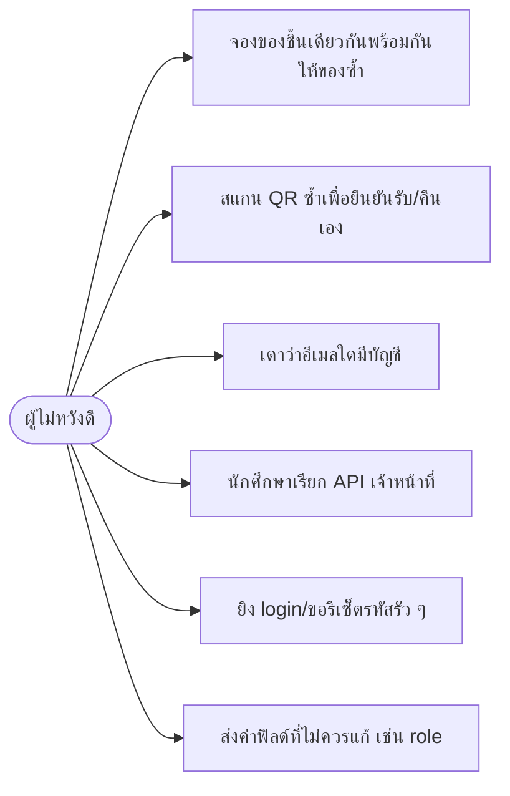

# 6. Threat Analysis

## 6.1 Threat Modeling ด้วย Data Flow Diagram (DFD)

DFD ระดับ 1 พร้อม **trust boundary** (เส้นประ = ขอบเขตความเชื่อถือที่ข้อมูลข้ามไป)

**Trust boundary ที่ต้องเฝ้า:**
1. ผู้ใช้ → ระบบ (ทุก input ไม่เชื่อถือ ต้อง validate)
2. nginx → backend (ปิด `/api/admin/` จากภายนอก, อ่าน IP จริงผ่าน `NUM_PROXIES`)
3. backend → DB/MinIO (ใช้ ORM/parameterized เท่านั้น)
4. ระบบ → SMTP (ข้อมูลออกนอก ต้องระวังไม่หลุด token/ความลับในเนื้ออีเมล)

## 6.2 Misuse Cases (กรณีใช้งานในทางที่ผิด + มาตรการที่มีจริง)

| Misuse case | ภัย (STRIDE) | มาตรการที่ **มีอยู่ในโค้ดแล้ว** |
|-------------|--------------|------------------------------|
| MC1 จองชนกัน | Tampering / DoS เชิงตรรกะ | `transaction.atomic()` + `select_for_update(skip_locked=True)` (`services.py:93`) |
| MC2 สแกน QR ยืนยันเอง | Elevation / Tampering | QR lookup อ่านอย่างเดียว; เปลี่ยนสถานะได้เฉพาะเมื่อเจ้าหน้าที่กดปุ่ม (`services.py:8-10`, `BOOKING_MODULE_NOTES.md`) |
| MC3 เดาบัญชี | Information Disclosure | login ตอบข้อความกลาง; password-reset ตอบเหมือนกันทุกกรณี ไม่บอกว่าอีเมลมีจริงไหม และไม่ log ลิงก์ (`views.py:178-179`) |
| MC4 ข้ามบทบาท | Elevation of Privilege | `IsStaffUser`/`IsStudentUser` + default `IsAuthenticated` (`permissions.py`, `settings.py:151`) |
| MC5 brute-force | DoS / Spoofing | throttle: login 20/min, reset 10/hr, public 120/min (`settings.py:154-161`) |
| MC6 mass-assignment | Tampering / Elevation | serializer whitelist ฟิลด์ที่แก้ได้; email/role ควบคุมฝั่งเซิร์ฟเวอร์ (`serializers.py` ProfileUpdateSerializer, `views.py` StaffStudentDetailView) |

## 6.3 Asset List (ทรัพย์สินที่ต้องปกป้อง)

| รหัส | ทรัพย์สิน | ที่เก็บ | ระดับความอ่อนไหว |
|:---:|-----------|---------|:---:|
| AS-1 | รหัสผ่านผู้ใช้ (แฮช PBKDF2-SHA256) | PostgreSQL | สูงมาก |
| AS-2 | Token ยืนยันตัวตน (DRF authtoken) | PostgreSQL / localStorage ฝั่ง client | สูงมาก |
| AS-3 | ข้อมูลส่วนบุคคล (ชื่อ, อีเมล, รหัสนักศึกษา, รูปโปรไฟล์) | PostgreSQL + MinIO | สูง |
| AS-4 | ประวัติการยืม-คืน (ใคร ยืมชิ้นไหน เมื่อไร สภาพอุปกรณ์) | PostgreSQL | กลาง-สูง |
| AS-5 | ประวัติการส่งอีเมล (NotificationLog: อีเมลผู้รับ) | PostgreSQL | กลาง |
| AS-6 | ค่าตั้งระบบ (PenaltySettings) | PostgreSQL | กลาง |
| AS-7 | ไฟล์สำรองฐานข้อมูล (มีข้อมูลผู้ใช้จริง) | โฟลเดอร์ `backups/` (git-ignored) | สูงมาก |
| AS-8 | ความลับระบบ (`DJANGO_SECRET_KEY`, รหัส DB/MinIO/SMTP) | ไฟล์ `.env` (git-ignored) | สูงมาก |

## 6.4 Security Requirements (ผูกกับ STRIDE)

| รหัส | ความต้องการด้านความปลอดภัย | STRIDE | ยืนยันได้ที่ |
|:---:|-----------------------------|--------|-------------|
| SR-1 | ผู้ใช้ทุกคนต้องยืนยันตัวตนก่อนเข้าถึง API (ยกเว้นหน้าสาธารณะที่กำหนด) | Spoofing | `settings.py:151` default `IsAuthenticated` |
| SR-2 | แยกสิทธิ์ตามบทบาท นักศึกษา/เจ้าหน้าที่ | Elevation | `permissions.py` |
| SR-3 | รหัสผ่านต้องถูกแฮชและมีนโยบายความแข็งแรง | Information Disclosure | `settings.py:100-108` |
| SR-4 | ป้องกัน SQL Injection ทุก query | Tampering | ใช้ Django ORM ล้วน ไม่มี raw SQL |
| SR-5 | ตรวจความถูกต้องของ input ทุกจุด (รวมขนาด/ชนิดไฟล์อัปโหลด ≤ 5MB) | Tampering | `serializers.py` validators |
| SR-6 | จำกัดความถี่ปลายทางที่อ่อนไหว (login/reset) | DoS | `settings.py:154-161` |
| SR-7 | ไม่เปิดเผยว่าบัญชี/อีเมลใดมีอยู่ | Information Disclosure | `views.py:178-179` |
| SR-8 | ความลับทั้งหมดอ่านจาก `.env` ห้าม hardcode + กันบูตด้วยคีย์ตัวอย่างใน production | Information Disclosure | `settings.py:13-19` |
| SR-9 | เปลี่ยน/รีเซ็ตรหัสผ่านต้องเพิกถอน token เดิม | Spoofing | `views.py:145-148,206` |
| SR-10 | การเปลี่ยนสถานะสำคัญต้อง atomic + ตรวจสอบย้อนหลังได้ (log/ PROTECT) | Repudiation / Tampering | `services.py`, `models.py:259,262`, `NotificationLog` |

> รายละเอียดหลักฐานเชิงโค้ดของแต่ละ control อยู่ใน [08-secure-coding-and-refactor.md](08-secure-coding-and-refactor.md) และตารางโยงถึงเทสต์ใน [09-traceability-matrix.md](09-traceability-matrix.md)
