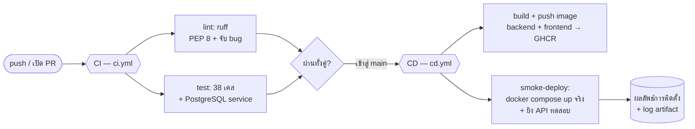

# 10. การติดตั้งแบบอัตโนมัติ (CI / CD) — 40%

> โครงงานเดิม **ยังไม่มี** pipeline เฟสนี้จึงเพิ่ม GitHub Actions จริง 2 ไฟล์ที่ `.github/workflows/`

## 10.1 ภาพรวม Pipeline



## 10.2 กระบวนการ CI (Continuous Integration) — `.github/workflows/ci.yml`

ทำงานทุก `push` และ `pull_request` มี 2 job:

**1) `lint`** — ติดตั้ง `ruff` แล้วรัน `ruff check .` (อ่านกฎจาก `backend/pyproject.toml`)

**2) `test`** — ยก **PostgreSQL 16** เป็น service container แล้ว:
```yaml
services:
  postgres:
    image: postgres:16-alpine
    options: --health-cmd "pg_isready -U postgres" --health-interval 5s ...
env:
  DB_HOST: localhost
  DB_PORT: "5432"
  DJANGO_SECRET_KEY: ci-only-not-a-real-secret
  USE_X_FORWARDED_PROTO: "true"   # จำเป็นต่อเทสต์ลิงก์รีเซ็ตรหัส (ส่ง X-Forwarded-Proto=https)
steps:
  - pip install -r backend/requirements.txt
  - python manage.py makemigrations --check --dry-run   # กันลืมสร้าง migration
  - python manage.py test --verbosity 2                 # รัน 38 เคส
```
> ค่าแวดล้อม `DB_*` ตรงกับที่ `backend/config/settings.py:86-95` อ่านผ่าน `python-decouple` — ชุดทดสอบจะสร้างฐานข้อมูล `test_it_lending_db` ให้เองและลบทิ้งเมื่อจบ

## 10.3 กระบวนการ CD (Continuous Deployment) — `.github/workflows/cd.yml`

ทำงานเมื่อเข้าสู่ `main`, สร้าง tag `v*`, หรือกด **Run workflow** เอง มี 2 job:

**1) `build-and-push`** — build Docker image ของ `backend` และ `frontend` (แบบขนานด้วย matrix) แล้ว push ขึ้น **GitHub Container Registry (ghcr.io)** ด้วย `GITHUB_TOKEN` → เห็น image ในแท็บ **Packages** ของ repo (tag ทั้ง `:latest` และ `:<commit sha>`)

**2) `smoke-deploy`** — พิสูจน์ว่า **ติดตั้งได้จริง**:
```bash
# 1. สร้าง .env สำหรับทดสอบ (ค่าตัวอย่าง)
# 2. ยกระบบจริงด้วย compose (frontend + db + minio + migrate + backend; ไม่ยก cloudflared)
docker compose up -d --build frontend
# 3. วนรอแล้วยิง request เข้าไปจริง — ต้องได้ HTTP 200
curl http://localhost:8080/api/public/equipment/
# 4. เก็บ docker compose logs เป็น artifact (หลักฐานผลการติดตั้ง) แล้ว down
```
ถ้า endpoint ตอบ `200` = ระบบ build + migrate ฐานข้อมูล + start + ให้บริการ API ได้สำเร็จ

## 10.4 แสดงผลลัพธ์การติดตั้ง (เติมตอนนำเสนอ)

ทีมได้รัน/ตรวจในเครื่องแล้วก่อนนำเสนอ ได้ผลดังนี้:
- `ruff check .` → **All checks passed!**
- `python manage.py test` (กับ PostgreSQL 16) → **Ran 38 tests … OK**
- `docker compose config` → ผ่าน (ค่าลับทั้งหมดใน `.env` ครบ)

**สิ่งที่ต้องแคปหน้าจอใส่สไลด์ (หลัง push ขึ้น GitHub):**
1. หน้า **Actions** แสดง workflow **CI** ติ๊กเขียว (job `lint` + `test`)
2. หน้า **Actions** แสดง workflow **CD** ติ๊กเขียว (job `build-and-push` + `smoke-deploy`) และบรรทัด `✅ ติดตั้งสำเร็จ: GET /api/public/equipment/ ตอบ 200`
3. แท็บ **Packages** แสดง image `...-backend` และ `...-frontend`
4. (ถ้าทำ) ภาพเว็บที่เปิดผ่าน URL `*.trycloudflare.com`

```
[ พื้นที่สำหรับวางภาพ screenshot ผลการรัน Actions / Packages / หน้าเว็บจริง ]
```

## 10.5 วิธีรันเพื่อสาธิต

**ติดตั้งจริงทั้งระบบ (เครื่องที่มี Docker):**
```bash
cp .env.docker.example .env      # แล้วกรอกค่าลับให้ครบ
docker compose up -d --build
docker compose logs cloudflared | grep trycloudflare   # ได้ URL สาธารณะ
```
**ให้ pipeline รันบน GitHub:** push โค้ดขึ้น repo แล้วเปิดแท็บ **Actions** — CI รันทันที; เมื่อเข้าสู่ `main` CD จะ build image + smoke deploy ให้อัตโนมัติ (หรือกด **Run workflow** เพื่อสาธิตสด)

> หมายเหตุ: ไฟล์ workflow จะเริ่มทำงานก็ต่อเมื่อถูก **push ขึ้น GitHub** แล้วเท่านั้น — ตอนนี้ไฟล์ถูกเพิ่มในโปรเจกต์เรียบร้อย รอการ push เพื่อให้เห็นผลเขียวบนหน้า Actions
